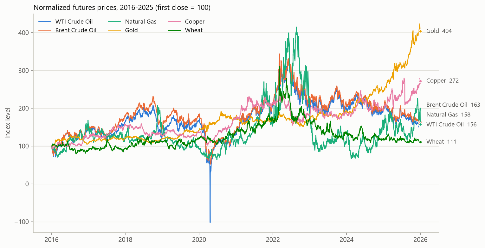
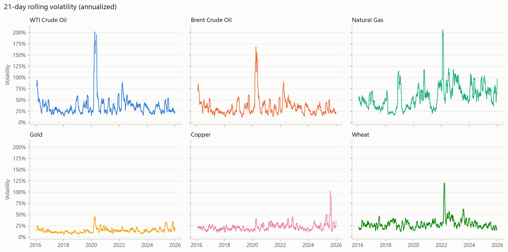
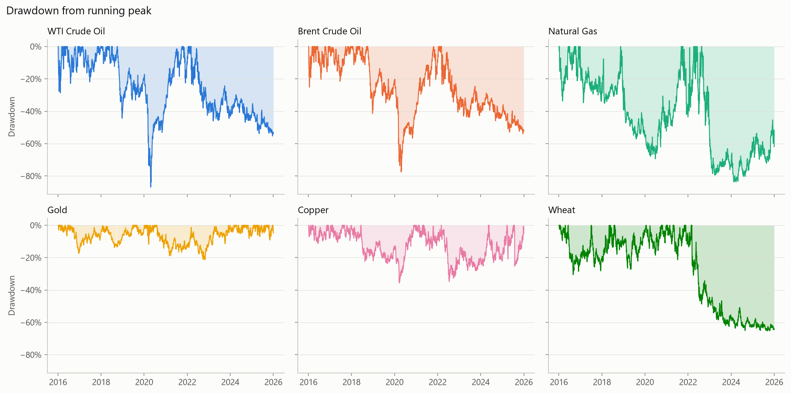
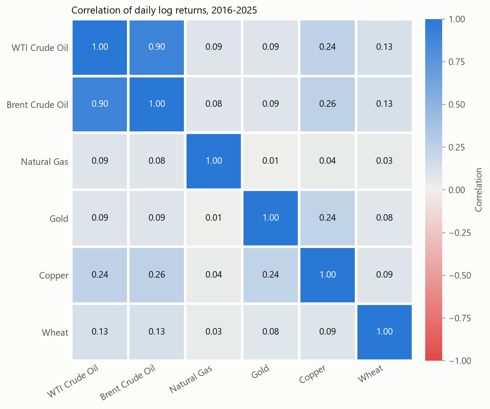

# commodity-sql-analytics

SQL data quality checks and analytics on 10 years (2016-2025) of daily prices for six
commodity futures: WTI crude oil, Brent crude oil, natural gas, gold, copper and wheat.
Prices are downloaded from Yahoo Finance and loaded into DuckDB exactly as received, with no
cleaning in Python. All the work is done in plain SQL files. Free market data has gaps and
errors, so the data is validated before it is analyzed: missing days, zero-volume and flat
bars, OHLC consistency, non-positive prices, duplicate keys and extreme daily moves. Rows that
fail the checks are flagged in a clean view, and every analysis query reads from that view.

## Key findings

- **Data quality:** 15,085 rows with no duplicate keys or NULL prices, but real issues: gold and
  copper missing on 2018-01-29, zero volume on open market days, 29 placeholder rows and 1 OHLC
  inconsistency. Negative WTI prices are kept as real data.
- **Risk:** natural gas is the most volatile series (64.5% annualized), about four times gold (15.6%).
- **Performance:** gold ends at 403.8 (first close = 100) with the lowest volatility and the
  smallest max drawdown (-21.2%); wheat ends at 110.6, close to its max drawdown.
- **Correlation:** WTI and Brent are highly correlated (0.895); all other pairs are below 0.26,
  and natural gas is close to uncorrelated with everything.
- **Cleaning choices change results:** WTI and Brent end at almost the same level (156.2 vs
  163.5), but WTI shows a mean return of 10.5% vs 4.9%, because the negative-price returns are
  excluded.

## Tech stack and repo structure

- **Python 3.12.3** to download the data, load it and run the SQL files
- **DuckDB** as the SQL engine (a single local database file)
- **yfinance** for the price data, **pandas** and **pyarrow** for loading it
- **matplotlib** for the charts

```
commodity-sql-analytics/
├── src/              Python scripts: download, load, build views, run a query, make charts
├── sql/
│   ├── quality/      Data quality checks on the raw prices table (01-10)
│   ├── views/        prices_clean view: quality flags, simple and log returns
│   ├── analysis/     Return statistics, rolling volatility, drawdowns, correlations
│   └── charts/       Queries that feed the charts
├── reports/figures/  Charts generated by make_charts.py
└── data/             Raw parquet file and DuckDB database (created locally, not in git)
```

## How to run

From the repo root in PowerShell:

```powershell
# 1. Create the virtual environment and install the requirements
python -m venv .venv
.venv\Scripts\python.exe -m pip install -r requirements.txt

# 2. Download the raw prices to data/raw_prices.parquet
.venv\Scripts\python.exe src\download.py

# 3. Load the prices and instruments tables into data/commodities.duckdb
.venv\Scripts\python.exe src\ingest.py

# 4. Create the views (prices_clean)
.venv\Scripts\python.exe src\build_views.py

# 5. Run any SQL file and print the result (read-only)
.venv\Scripts\python.exe src\run_sql.py sql\quality\01_missing_days.sql

# 6. Generate the charts in reports/figures/
.venv\Scripts\python.exe src\make_charts.py
```

## Data quality findings

The raw `prices` table has 15,085 rows and is never modified: every check reads it as loaded,
and problem rows are only flagged in the `prices_clean` view.

| Check | SQL file | Result |
|---|---|---|
| Missing days vs weekday calendar | [01](sql/quality/01_missing_days.sql), [02](sql/quality/02_missing_days_summary.sql) | 94-96 of 2,609 weekdays missing per ticker; on 94 dates all six tickers are missing |
| Dates missing only for some tickers | [03](sql/quality/03_missing_days_partial.sql) | 3 dates: 2018-01-29 (gold, copper), 2023-11-23 (WTI, wheat), 2025-07-04 (wheat) |
| Zero-volume rows | [04](sql/quality/04_suspicious_rows.sql), [05](sql/quality/05_suspicious_by_year.sql), [06](sql/quality/06_zero_volume_dates.sql) | 67 rows (0 rows with NULL volume) |
| Flat bars (open = high = low = close) | [04](sql/quality/04_suspicious_rows.sql), [05](sql/quality/05_suspicious_by_year.sql) | 224 rows, none for WTI or natural gas; 29 of them also have volume = 0 |
| Duplicate keys (ticker, date) | [07](sql/quality/07_integrity_checks.sql) | 0 |
| NULL prices | [07](sql/quality/07_integrity_checks.sql) | 0 |
| Non-positive prices | [07](sql/quality/07_integrity_checks.sql), [08](sql/quality/08_integrity_detail.sql) | 2 rows: WTI on 2020-04-20 and 2020-04-21 |
| OHLC inconsistencies | [07](sql/quality/07_integrity_checks.sql), [08](sql/quality/08_integrity_detail.sql) | 1 row: copper on 2019-05-17, open 2.76 above high 2.7505 |
| Largest daily moves | [09](sql/quality/09_largest_moves.sql) | WTI -306% on 2020-04-20 (close 18.27 to -37.63); largest outside WTI: natural gas +46.5% on 2022-01-27 |

Main findings:

1. **Gold and copper are missing on 2018-01-29**, a normal Monday on which the other four
   tickers have prices.
2. **Volume = 0 on open market days.** All six tickers have volume = 0 on 2023-04-06,
   2025-06-18, 2025-07-03, 2025-08-29 and 2025-11-03, and wheat also on 2025-06-05. None of
   these rows is a flat bar, so prices moved: here 0 means missing volume, not no trading.
   `prices_clean` turns these zeros into NULL. (2025-07-04, a US holiday, also has volume = 0
   for the five tickers that have a row.)
3. **Gold has placeholder rows in 2017-2019**: 28 rows (1 in 2017, 18 in 2018, 9 in 2019)
   with a flat bar and volume = 0, plus 1 Brent row in 2016, 29 in total. Four of the gold
   rows are consecutive trading days (19, 20, 21 and 24 September 2018, see
   [11](sql/quality/11_suspect_rows.sql)). The missing-days check cannot see them
   because the rows exist. `prices_clean` marks these rows as suspect.
4. **Negative WTI prices on 2020-04-20 are real market prices, not errors.** WTI closed at
   -37.63 that day and opened at -14.00 the next day. Both rows have consistent OHLC values
   and volume (247,947 and 2,288,230), so they stay in `prices_clean`; returns are left NULL
   where the close or the previous close is not positive.

## Cleaning decisions

The `prices` table is never modified. The [`prices_clean`](sql/views/prices_clean.sql) view
applies these decisions without deleting any row:

- **Volume = 0 becomes NULL**: it is treated as missing volume, not as zero trading.
- **Four flags** mark each issue: `flag_zero_volume`, `flag_flat_bar`, `flag_ohlc_inconsistent`
  and `flag_non_positive`.
- **`is_suspect`** = (zero volume AND flat bar) OR OHLC inconsistent; the analysis queries
  exclude these rows.
- **`ret` and `log_ret` are NULL** when the close or the previous close is zero or negative.
- **Validation** ([10](sql/quality/10_clean_view_check.sql)): the view keeps all 15,085 rows;
  30 are suspect (28 gold, 1 Brent, 1 copper), 67 have NULL volume and 8 have NULL returns
  (the first row of each ticker, plus WTI on 2020-04-20 and 2020-04-21).

## Analysis results

All analysis queries read `prices_clean` and exclude `is_suspect` rows.

### Returns and volatility

[01_return_stats.sql](sql/analysis/01_return_stats.sql); final index from
[05_final_values.sql](sql/analysis/05_final_values.sql) (first close = 100).

| Instrument | N returns | Ann. mean log return | Ann. volatility | Worst day | Best day | Final index |
|---|---|---|---|---|---|---|
| Natural Gas (NG=F) | 2,514 | 4.6% | 64.5% | -26.0% | 46.5% | 157.9 |
| WTI Crude Oil (CL=F) | 2,511 | 10.5% | 45.0% | -24.6% | 37.7% | 156.2 |
| Brent Crude Oil (BZ=F) | 2,513 | 4.9% | 39.2% | -24.4% | 21.0% | 163.5 |
| Wheat (ZW=F) | 2,512 | 1.0% | 31.2% | -10.7% | 21.8% | 110.6 |
| Copper (HG=F) | 2,512 | 10.1% | 24.3% | -22.3% | 13.3% | 271.9 |
| Gold (GC=F) | 2,485 | 13.5% | 15.6% | -5.7% | 5.9% | 403.8 |



Natural gas is the most volatile series (64.5% annualized), about four times gold (15.6%).
Gold has the highest mean log return and the lowest volatility, and ends at 403.8, the highest
of the six; wheat ends at 110.6, with the lowest mean return (1.0%).

**Note on WTI:** its mean log return (10.5%) is inflated. The two NULL returns of April 2020
leave out the fall from 18.27 to 10.01 but keep the rebound that follows. WTI ends at 156.2 and
Brent at 163.5, almost the same, yet the table gives WTI more than twice Brent's mean return
(10.5% vs 4.9%).

### Rolling volatility peaks

[02_rolling_vol_peaks.sql](sql/analysis/02_rolling_vol_peaks.sql): highest 21-day volatility
(annualized) per instrument, using only full 21-return windows.

| Instrument | Peak date | Peak 21-day volatility |
|---|---|---|
| Natural Gas (NG=F) | 2022-02-09 | 206.1% |
| WTI Crude Oil (CL=F) | 2020-04-03 | 201.8% |
| Brent Crude Oil (BZ=F) | 2020-04-03 | 168.1% |
| Wheat (ZW=F) | 2022-03-21 | 120.6% |
| Copper (HG=F) | 2025-08-01 | 101.7% |
| Gold (GC=F) | 2020-03-27 | 45.3% |



The oil peaks (2020-04-03) and the gold peak (2020-03-27) coincide with the COVID-19 market
sell-off. The wheat peak (2022-03-21) coincides with the weeks after Russia's invasion of
Ukraine.

**Notes:** the gap in the WTI line (2020-04-17 to 2020-05-20) is made of windows excluded for
having fewer than 21 returns, so the real WTI peak during the crash cannot be measured this
way. The natural gas peak window includes 27 and 28 January 2022, its best (+46.5%) and worst
(-26.0%) days in the sample; these moves may be a contract roll effect (not verified).

### Maximum drawdowns

[03_max_drawdown.sql](sql/analysis/03_max_drawdown.sql): largest fall from a running peak
(positive closes only); final drawdown from
[05_final_values.sql](sql/analysis/05_final_values.sql).

| Instrument | Prior peak | Trough date | Trough close | Max drawdown | Final drawdown |
|---|---|---|---|---|---|
| WTI Crude Oil (CL=F) | 76.41 | 2020-04-21 | 10.01 | -86.9% | -53.6% |
| Natural Gas (NG=F) | 9.68 | 2024-03-26 | 1.58 | -83.7% | -61.9% |
| Brent Crude Oil (BZ=F) | 86.29 | 2020-04-21 | 19.33 | -77.6% | -52.5% |
| Wheat (ZW=F) | 1425.25 | 2025-09-10 | 495.00 | -65.3% | -64.4% |
| Copper (HG=F) | 3.29 | 2020-03-23 | 2.12 | -35.6% | -2.8% |
| Gold (GC=F) | 2069.40 | 2022-11-03 | 1630.90 | -21.2% | -4.6% |



Wheat ends the period at -64.4%, close to its maximum drawdown (-65.3%). Gold (-4.6%) and
copper (-2.8%) end near their running peaks, while WTI, Brent and natural gas end 52-62% below
theirs. The oil troughs (2020-04-21) and the copper trough (2020-03-23) coincide with the
COVID-19 sell-off.

**Note on WTI:** the -86.9% excludes the negative close. From the 76.41 peak to the -37.63
close of 2020-04-20, the real drawdown was more than 100%.

### Correlations

[04_correlations.sql](sql/analysis/04_correlations.sql): correlation of daily log returns on
the days both instruments have a return.



WTI and Brent are by far the most correlated pair (0.895). Natural gas is close to
uncorrelated with everything: its highest correlation is 0.092 (with WTI) and its lowest
0.012 (with gold). Outside the oil pair, the highest values all involve copper: with Brent
(0.257), WTI (0.245) and gold (0.242).

## Limitations

- Continuous front-month futures (=F) include roll jumps; the natural gas moves of 2022-01-27/28 and 2024-04-29 may be roll effects (not verified).
- Excluding the negative-price returns biases the WTI mean return upward, hides the real WTI drawdown (>100%) and removes the rolling volatility around April-May 2020.
- Yahoo Finance data has gaps and placeholder rows (see [Data quality findings](#data-quality-findings)), and past values can change between downloads.
- Correlations are full-period averages and do not show how they change over time.
- External events are mentioned only as coinciding with the data, not as causes.

## SQL techniques used

- CTEs: [quality/01](sql/quality/01_missing_days.sql)
- LEFT JOIN against a generated calendar (`generate_series`): [quality/01](sql/quality/01_missing_days.sql)
- CROSS JOIN: [quality/01](sql/quality/01_missing_days.sql)
- GROUP BY / HAVING: [quality/03](sql/quality/03_missing_days_partial.sql)
- STRING_AGG: [quality/03](sql/quality/03_missing_days_partial.sql)
- CASE WHEN aggregation: [quality/04](sql/quality/04_suspicious_rows.sql)
- Subqueries: [quality/07](sql/quality/07_integrity_checks.sql)
- COALESCE: [quality/07](sql/quality/07_integrity_checks.sql); NULLIF: [views/prices_clean](sql/views/prices_clean.sql)
- Window function LAG: [quality/09](sql/quality/09_largest_moves.sql)
- Views: [views/prices_clean](sql/views/prices_clean.sql)
- ROW_NUMBER, rolling STDDEV with ROWS BETWEEN, named WINDOW: [analysis/02](sql/analysis/02_rolling_vol_peaks.sql)
- Running MAX with UNBOUNDED PRECEDING: [analysis/03](sql/analysis/03_max_drawdown.sql)
- Self-join with CORR: [analysis/04](sql/analysis/04_correlations.sql)
- FIRST_VALUE: [analysis/05](sql/analysis/05_final_values.sql)
